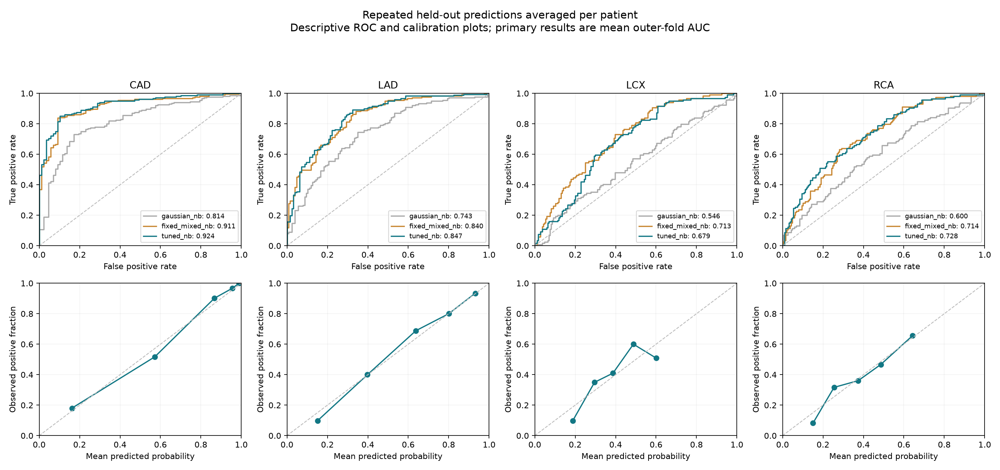

# Naive Bayes results

303 patients; four independently modeled outcomes; no web application.

## Primary ROC-AUC comparison

Mean of 15 held-out outer folds (5 folds × 3 repeats). Tuned configurations
are selected by 4-fold inner CV. Standard deviations describe variation
across folds, not confidence intervals.

| Target | Gaussian NB | Fixed mixed NB | Tuned mixed NB | Tuned fold SD |
|---|---:|---:|---:|---:|
| CAD | 0.8507 | 0.9090 | 0.9208 | 0.0371 |
| LAD | 0.7955 | 0.8380 | 0.8427 | 0.0431 |
| LCX | 0.6207 | 0.7167 | 0.6798 | 0.0709 |
| RCA | 0.6385 | 0.7157 | 0.7222 | 0.0444 |

Tuning improved the observed mean AUC for CAD, LAD, and RCA, but harmed LCX.
The fixed LCX model had the stronger observed ranking performance. Both
variants are saved; the default inference folder contains the tuned models.
Use `--models artifacts/fixed` for fixed mixed NB. A preference for fixed LCX
based on this comparison is exploratory: selecting a method on outer results
does not produce an unbiased estimate of a newly combined selection strategy.
The small LAD/RCA differences do not establish statistical superiority.

## Tuned models: threshold trade-offs

The saved thresholds maximize balanced accuracy on training-only cross-fitted
predictions. They do not maximize every metric simultaneously.

| Target | Accuracy | Precision | Recall | Specificity | F1 | Balanced accuracy |
|---|---:|---:|---:|---:|---:|---:|
| CAD | 0.8403 | 0.9327 | 0.8364 | 0.8497 | 0.8807 | 0.8430 |
| LAD | 0.7625 | 0.7885 | 0.8175 | 0.6847 | 0.7994 | 0.7511 |
| LCX | 0.6302 | 0.5245 | 0.6440 | 0.6214 | 0.5733 | 0.6327 |
| RCA | 0.6314 | 0.5145 | 0.6760 | 0.6052 | 0.5775 | 0.6406 |

At the conventional 0.5 probability threshold:

| Target | Accuracy | Precision | Recall | F1 |
|---|---:|---:|---:|---:|
| CAD | 0.8613 | 0.8934 | 0.9166 | 0.9040 |
| LAD | 0.7690 | 0.7897 | 0.8268 | 0.8063 |
| LCX | 0.6247 | 0.5057 | 0.3676 | 0.4193 |
| RCA | 0.6765 | 0.6069 | 0.4274 | 0.4935 |

ROC-AUC is unchanged by the classification threshold. For CAD, 0.5
gives higher accuracy/F1 and recall, while the tuned threshold favors
specificity and balanced accuracy. Vessel thresholds generally recover
more positives at the expense of specificity.

## Ranking, probability quality, and uncertainty

| Target | Average precision | Brier (lower better) | Log loss (lower better) | Repeat mean AUC range |
|---|---:|---:|---:|---:|
| CAD | 0.9681 | 0.1018 | 0.3229 | 0.9181–0.9232 |
| LAD | 0.8789 | 0.1569 | 0.4802 | 0.8375–0.8458 |
| LCX | 0.5556 | 0.2210 | 0.6314 | 0.6576–0.6962 |
| RCA | 0.6215 | 0.2037 | 0.5936 | 0.7163–0.7308 |

The calibrated tuned systems have lower Brier/log loss than the fixed
uncalibrated comparisons. This evaluates the whole system; it does not isolate
calibration from model changes. A naive classifier predicting observed class
prevalence has expected ROC-AUC 0.5; average precision should be interpreted
relative to each target prevalence.

The figure averages three held-out predictions per patient; its AUC values
are secondary descriptive measures and differ from the primary fold means.
Conditional patient-bootstrap intervals are in `summary.csv`. They keep
fitted predictions fixed and omit retraining/model-selection uncertainty.

## Audit and validation limits

- Positive counts: {'Cath': 216, 'LAD': 177, 'LCX': 119, 'RCA': 114}.
- Supplied CAD/vessel disagreement occurs at CSV line(s) [95]; labels were preserved.
- All Cath/LAD/LCX/RCA columns are excluded from every model input.
- No missing values or duplicate feature rows in the supplied data.
- Missing values, unseen categorical values, feature selection, scaling, and bins are handled within training folds.
- Raw Gaussian NB can be badly miscalibrated for rare binary findings; this explains poor threshold metrics despite useful ranking.
- No independent external cohort or patient/site/time identifiers were supplied.
- LCX/RCA discrimination is modest. More data and external validation are needed before claiming reliable generalization.
- Final saved models are trained on all 303 rows and have no independent test score.
- No result proves a global maximum ROC-AUC or guarantees performance on new populations.

Full search settings and exact package versions are in `manifest.json`;
individual predictions, metrics, and splits are retained for audit.

Method references: [nested cross-validation](https://scikit-learn.org/stable/auto_examples/model_selection/plot_nested_cross_validation_iris.html)
and [Naive Bayes](https://scikit-learn.org/stable/modules/naive_bayes.html).
